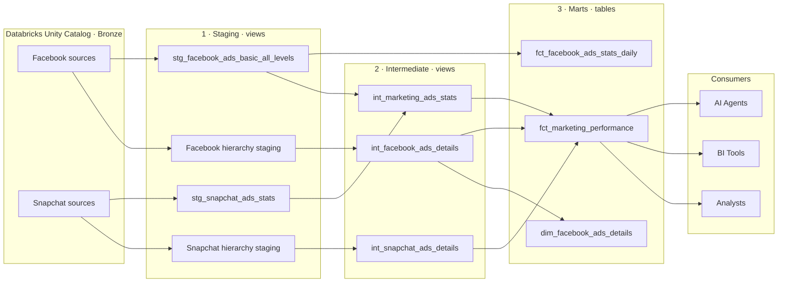
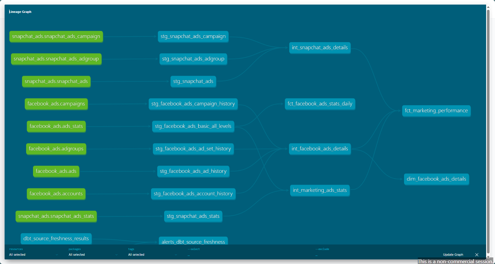
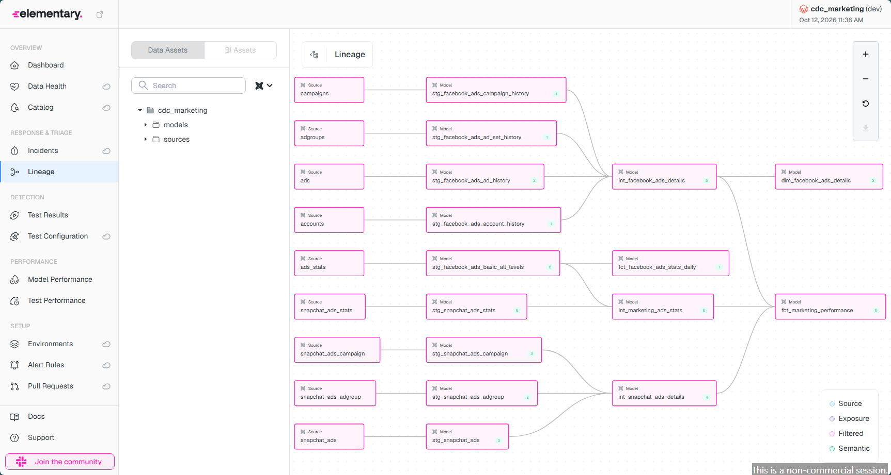
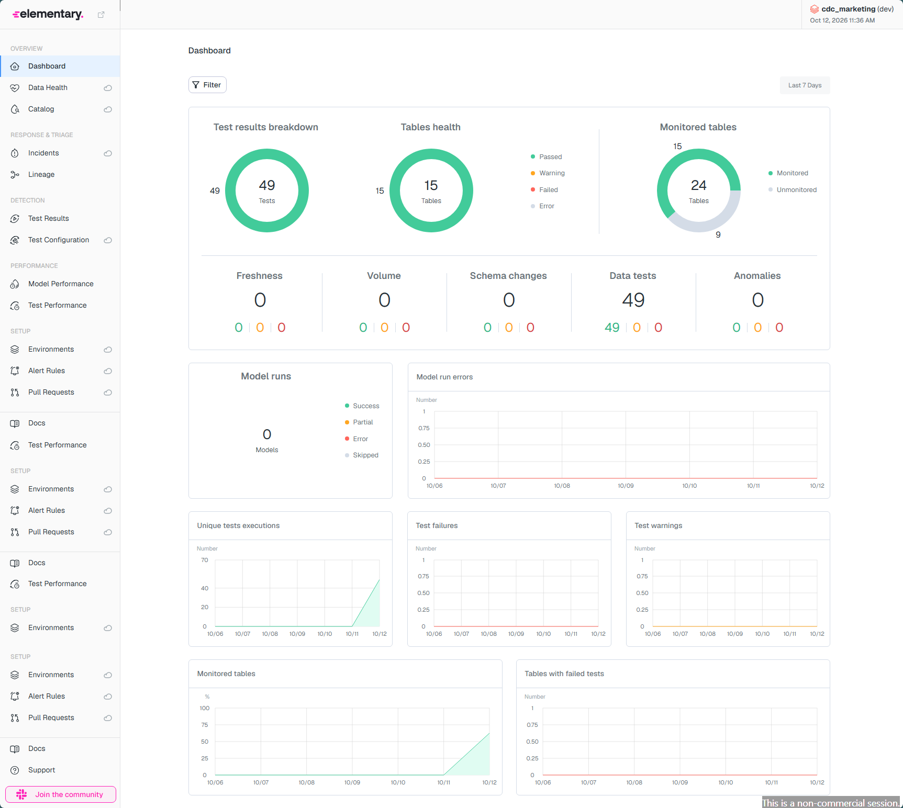
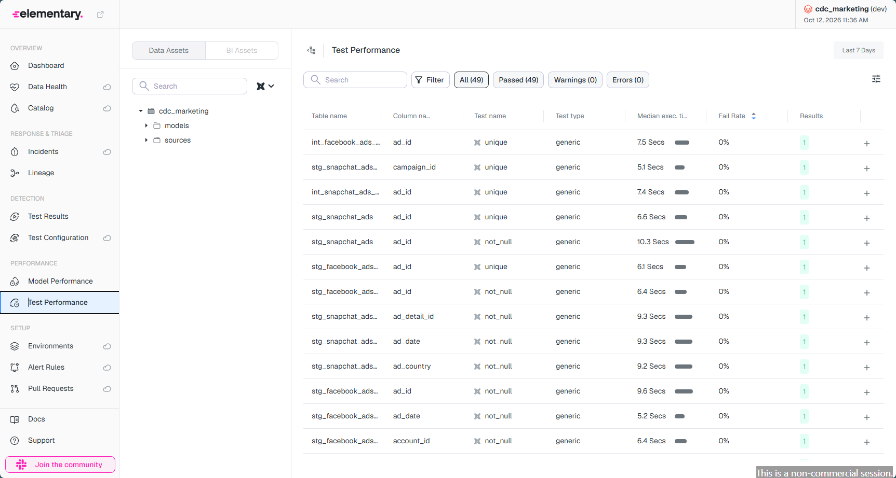
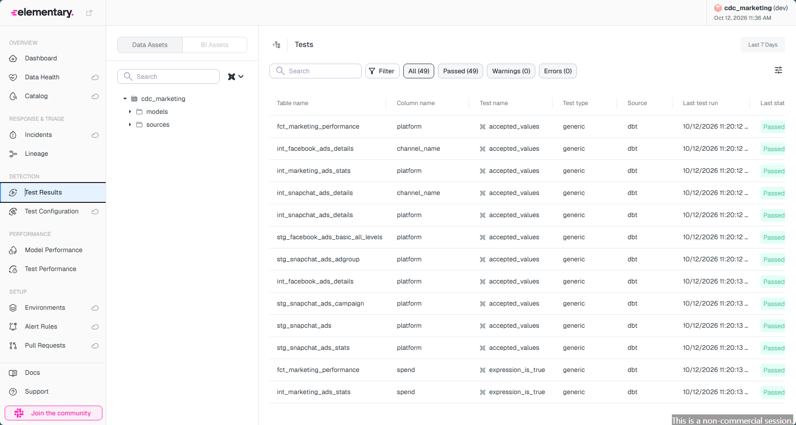

# Marketing Data Platform with Databricks & dbt

> A production-minded analytics engineering project that brings **Facebook Ads** and **Snapchat Ads** data together in one clear, tested, and well-documented marketing performance model for analysts, BI tools, and AI agents.

This repository is both a working analytics project and a record of the engineering decisions behind it. The aim is not to pretend that every production concern is finished; it is to show, honestly and clearly, what has been implemented, what has been prepared, and what still needs environment-specific verification.

---

## 1. Business Context & Problem

The Marketing team runs paid campaigns on multiple platforms (currently Facebook and Snapchat). To answer basic questions they currently have to:

- Log into each advertising platform separately
- Export data into Excel
- Manually combine and clean the files

This creates five concrete problems:

1. **Time-consuming analysis** – hours spent on repetitive manual work  
2. **No unified view** – different column names, structures and IDs across platforms  
3. **Limited accessibility** – data is trapped inside the Marketing team  
4. **Poor reusability** – other teams cannot easily build on the data  
5. **Limited governance** – no central model, documentation, lineage or automated quality checks  

**Goal of this project**  
Build a small but production-minded **Marketing Data Platform** that solves the problems above by delivering a reusable analytical data product.

---

## 2. What This Project Delivers

At the end of the pipeline an analyst (or an AI agent) can simply ask:

- How much did we spend on Facebook vs Snapchat?
- Which campaigns generated the most impressions and clicks?
- What is our CTR, CPC and CPM by platform / campaign / day?
- How is performance changing over time?

…and get a reliable answer from one table: **`fct_marketing_performance`**.

### Project status at a glance

The wording in this table is deliberate:

- **Implemented** means the code or artifact exists in this repository.
- **Configured** means the project structure is ready, but the target still needs valid credentials and a real environment run.
- **Pending verification** means completion cannot be claimed safely from repository files alone.

| Case Study Requirement | Current status | Evidence / honest boundary |
|------------------------|----------------|----------------------------|
| Raw Facebook & Snapchat data in Databricks | ✅ Implemented in development | Both sources point to `bronze_production.cdc_staging`; generated dbt and Elementary artifacts show that the development project has run |
| dbt project with staging → intermediate → marts | ✅ Implemented | Active SQL and YAML models exist across all three layers |
| Unified marketing model | ✅ Implemented | `fct_marketing_performance` combines both platforms |
| Clear grain and keys | ✅ Implemented for the key analytical models | Natural and composite keys are documented below; not every staging history model declares a formal contract |
| Data quality tests | ✅ Implemented | Uniqueness, not-null, accepted-values, composite-grain, non-negative metric, and hierarchy relationship tests exist |
| dbt documentation & lineage | ✅ Generated | Static lineage screenshot is included below |
| Elementary observability | ✅ Generated in development | The report artifact and screenshots exist; production monitoring is not yet verified |
| Environment separation | ✅ Verified | `dev`, `ci`, `staging`, and `production` targets exist. CI runs on every PR/main against isolated schema `cdc_ci`. Production target validated with Service Principal. |
| Production Service Principal | ✅ Verified | Production uses OAuth only (no PAT). `dbt debug --target production` passed. Full model subgraph materialised into `bronze_production.cdc_marts` (e.g. `fct_marketing_performance`: 92,300 Facebook + 1,052 Snapchat rows). |
| Unity Catalog permissions | ✅ Applied | Grants configured for development user and Service Principal on staging and production schemas. |
| Materialization strategy | ✅ Implemented | Views for staging/intermediate models; tables for marts |
| CI/CD workflow | ✅ Verified | The repository-root workflow completed successfully on the feature pull request using the CI Service Principal and isolated `cdc_ci` schema |
| README with architecture & decisions | ✅ Implemented | This document |

---

## 3. High-Level Architecture

```text
Facebook sources ──► Facebook staging ──► int_facebook_ads_details ──┐
        │                                                           │
        └──────────► Facebook daily staging ──┐                     │
                                              ├─► int_marketing_ ───┼─► fct_marketing_performance
        ┌──────────► Snapchat daily staging ──┘    ads_stats        │       + CTR / CPC / CPM
        │                                                           │
Snapchat sources ──► Snapchat staging ──► int_snapchat_ads_details ─┘

Supporting Facebook marts:
  int_facebook_ads_details ──► dim_facebook_ads_details
  Facebook daily staging ────► fct_facebook_ads_stats_daily

Consumers:
  fct_marketing_performance ──► Analysts / BI tools / AI agents
```

### Mermaid version (renders on GitHub)



The two Facebook-only marts are retained as useful supporting models. The cross-platform `fct_marketing_performance` model is the main product for unified reporting.

### Declared Bronze sources

| Platform | Source tables in `bronze_production.cdc_staging` |
|----------|--------------------------------------------------|
| Facebook | `accounts`, `campaigns`, `adgroups`, `ads`, `ads_stats` |
| Snapchat | `snapchat_ads_campaign`, `snapchat_ads_adgroup`, `snapchat_ads`, `snapchat_ads_stats` |

The repository contains the dbt source declarations and downstream transformations. It does not contain the upstream file-ingestion job, so the loading mechanism is treated as an external prerequisite rather than claimed as repository-managed ingestion.

### Why this layering?

| Layer | Responsibility | Materialization | Why this choice |
|-------|----------------|-----------------|-----------------|
| **Sources** | Point at raw Bronze tables, declare freshness | External | Gives lineage & freshness without copying data |
| **Staging** | Clean names, cast types, handle dirty values, add `platform` | **View** | Cheap, always up-to-date, easy to re-run |
| **Intermediate** | Latest hierarchy, business joins, grain alignment | **View** | Reusable logic, no extra storage cost |
| **Marts** | Final consumer-ready fact with KPIs | **Table** | Stable, performant surface for BI & AI |

---

## 4. Key Engineering Decisions (and Why)

### 4.1 Grain of the final model

> **One row = advertising performance of one ad on one platform on one day.**

This grain was chosen because:
- It answers the majority of business questions without further aggregation.
- It is the lowest common denominator after conforming Snapchat’s country-level data.
- It keeps the model simple enough for non-technical consumers and AI agents.

### 4.2 Model grain and key strategy

The project uses source-system identifiers rather than inventing surrogate keys where they are not yet needed. A single ID is sufficient for descriptive ad models; daily performance models use composite keys.

| Model | Purpose | Grain / key | Materialization |
|-------|---------|-------------|-----------------|
| `stg_facebook_ads_basic_all_levels` | Clean Facebook daily metrics | `ad_id + ad_date` | View |
| `stg_snapchat_ads_stats` | Clean Snapchat country-level metrics | `ad_detail_id + ad_date + ad_country` | View |
| `int_facebook_ads_details` | Latest Facebook ad hierarchy | `ad_id` | View |
| `int_snapchat_ads_details` | Latest Snapchat ad hierarchy | `ad_id` | View |
| `int_marketing_ads_stats` | Grain-aligned cross-platform metrics | `platform + ad_id + date_day` | View |
| `dim_facebook_ads_details` | Facebook descriptive attributes | `ad_id` | Table |
| `fct_facebook_ads_stats_daily` | Supporting Facebook daily fact | `ad_id + ad_date` | Table |
| `fct_marketing_performance` | Unified consumer-ready performance | `platform + ad_id + date_day` | Table |

The final fact’s composite key is protected with `dbt_utils.unique_combination_of_columns`. The details models use `unique` and `not_null` tests on `ad_id`.

### 4.3 Handling platform differences

| Issue | Facebook | Snapchat | How we solved it |
|-------|----------|----------|------------------|
| Metric column names | `ad_spend`, `ad_impressions`, `ad_clicks` | Same names but dirty strings | Standardised to `spend`, `impressions`, `clicks` in intermediate |
| History tables | Multiple versions per entity | Multiple versions for ad groups | `QUALIFY ROW_NUMBER() … = 1` to keep latest |
| Stats grain | ad + day | ad + day + **country** | Aggregated Snapchat to ad + day before union. In `int_marketing_ads_stats` we aggregated Snapchat (`SUM(spend)`, `SUM(impressions)`, `SUM(clicks)`) grouped by `ad_id` + `date_day` + `platform` so both platforms share the same grain before the `UNION ALL`. |
| Dirty values | Some `"null"` strings | Many `"null"` strings in clicks | `TRY_CAST` in both staging models → real SQL `NULL` |
| Account name | Available | Not available in current extract | Left as `NULL` for Snapchat (honest) |

#### Why Snapchat is aggregated before the union
Stats grain
    Facebook: ad + day
    Snapchat: ad + day + country
    → Aggregated Snapchat to ad + day before union
That aggregation happens in `int_marketing_ads_stats.sql` (the `snapchat_stats` CTE).

The staging model `stg_snapchat_ads_stats` correctly keeps the original country-level grain; we only collapse it when we need a common grain for the unified model.

### 4.4 Safe KPI calculations

```sql
CTR = clicks / impressions     → NULL when impressions = 0
CPC = spend / clicks           → NULL when clicks = 0
CPM = (spend / impressions) * 1000  → NULL when impressions = 0
```

Returning `NULL` is safer than returning 0 or causing a division error.

### 4.5 Materialization strategy

- Staging & Intermediate → **views** (low cost, always fresh)
- Final fact → **table** (better performance for repeated BI / AI queries)

This is a deliberate cost/performance trade-off documented for the assignment.

An incremental final fact was considered, but a table is the clearer choice for the current project size. Incremental processing would add merge logic and late-arriving-data handling before the available volume justifies that complexity. It remains a sensible next step if data volume or refresh frequency grows.

---

## 5. Data Quality Approach

We treat tests as a **contract** with downstream consumers.

| Test type | What it protects |
|-----------|------------------|
| `unique` / `unique_combination_of_columns` | Grain integrity (no silent fan-out) |
| `not_null` | Required business keys and dates |
| `accepted_values` | `platform` can only be `facebook` or `snapchat` |
| `expression_is_true` (`spend`, `impressions`, `clicks` ≥ 0) | Metric reasonableness |
| `relationships` | Enforces hierarchy links supported by the supplied extracts |
| Source freshness (2-day warn) | Stale data detection |

The generated Elementary screenshot below records **49 passing tests** from the earlier development run. The strengthened suite now has **69 data tests**, all of which passed in the isolated CI build.

One relationship is deliberately not enforced: the supplied Snapchat ad extract includes ads whose ad-group IDs are absent from the ad-group extract. The project keeps those ads through a left join rather than silently discarding their performance. Other hierarchy relationships supported by the source data remain tested.

---

## 6. Repository Structure

```text
.
├── .github/workflows/
│   └── dbt_ci.yml              # repository-root GitHub Actions workflow
├── docs/                       # screenshots referenced by this README
└── cdc_marketing/
    ├── models/
    │   ├── staging/
    │   │   ├── facebook/       # 5 staging models + sources.yml
    │   │   └── snapchat/       # 4 staging models + sources.yml
    │   ├── intermediate/
    │   │   ├── facebook/       # int_facebook_ads_details
    │   │   ├── snapchat/       # int_snapchat_ads_details
    │   │   └── int_marketing_ads_stats.sql
    │   └── marts/
    │       ├── dim/facebook/   # dim_facebook_ads_details
    │       ├── fact/facebook/  # fct_facebook_ads_stats_daily
    │       └── fct_marketing_performance.sql
    ├── macros/                 # schema and database naming
    ├── dbt_project.yml
    ├── profiles.yml            # dev / ci / staging / production
    ├── packages.yml            # dbt_utils, elementary, dbt_expectations
    ├── .env.template
    └── README.md
```

> **Repository layout note:** GitHub only discovers Actions workflows from `.github/workflows/` at the repository root. The workflow is now in that required location and will become active after the changes are committed and pushed.

### Useful project files

- [`profiles.yml`](cdc_marketing/profiles.yml) — Databricks targets and authentication
- [`dbt_project.yml`](cdc_marketing/dbt_project.yml) — model paths and materializations
- [`int_marketing_ads_stats.sql`](cdc_marketing/models/intermediate/int_marketing_ads_stats.sql) — cross-platform grain alignment
- [`fct_marketing_performance.sql`](cdc_marketing/models/marts/fct_marketing_performance.sql) — unified analytical model
- [`dbt_ci.yml`](.github/workflows/dbt_ci.yml) — repository-root CI workflow

---

## 7. How to Run the Project

### Prerequisites
- Python 3.11+
- `uv`
- Databricks workspace access + SQL warehouse
- Personal Access Token (for `dev`) or Service Principal (for other targets)

If `uv` is not installed yet:

```bash
python -m pip install uv
```

### 7.1 Documentation and Observability

### dbt Documentation (Static HTML)

dbt can generate a complete, self-contained documentation website that includes:

- Model and column descriptions
- Tests
- Source freshness configuration
- Interactive lineage graph

To generate the **static** documentation site (recommended for the assignment):

```bash
uv run dbt docs generate --static --profiles-dir .
```
After the command finishes, open the main file:
```text
target/static_index.html
```

#### dbt lineage graph

The generated static documentation provides end-to-end lineage from the Facebook and Snapchat sources through staging and intermediate models to the final marketing performance fact table.



To browse the documentation interactively (optional):
```bash
uv run dbt docs serve --profiles-dir .
```

### Elementary Observability Report
Elementary is integrated into the project and records test results, model runs, and data quality signals.
To generate the Elementary HTML report:

```bash
uv run edr report --profiles-dir .
```
The report is written to:
```text
edr_target/elementary_report.html
```

#### Elementary report screenshots

The Elementary dashboard summarizes test outcomes, table health, monitored tables, and recent observability signals.



The lineage view shows how source and transformed models feed the final marketing performance model.



The test results view provides the status of individual data quality checks.



The test performance view reports execution times, failure rates, and historical results.



The dashboard shows **15 monitored tables out of 24 resources**. That split matches this project’s structure: 15 active dbt models are monitored through dbt runs and tests, while the remaining nine resources are the declared raw Facebook and Snapchat sources. Those source tables are represented in lineage and freshness configuration but are not transformed models owned by this project.

### Environment variables

For local development, copy the template and replace its placeholders:

```bash
cd cdc_marketing
cp .env.template .env
```

```bash
# Development (PAT)
export DBT_TARGET=dev
export DEV_CATALOG=bronze_production
export DEV_SCHEMA=cdc_staging
export DEV_HTTP_PATH=/sql/1.0/warehouses/<your-warehouse-id>
export DATABRICKS_PAT_TOKEN=<your-pat>

# CI / Staging / Production (Service Principal)
export DBX_ID_APPLICATION_ID=<service-principal-application-id>
export DBX_SECRET=<service-principal-client-secret>

# Set the values for the target you intend to run
export CI_CATALOG=bronze_production
export CI_SCHEMA=cdc_ci
export CI_HTTP_PATH=/sql/1.0/warehouses/<your-warehouse-id>

export STAGING_CATALOG=bronze_production
export STAGING_SCHEMA=cdc_staging
export STAGING_HTTP_PATH=/sql/1.0/warehouses/<your-warehouse-id>

export PROD_CATALOG=bronze_production
export PROD_SCHEMA=cdc_marts
export PROD_HTTP_PATH=/sql/1.0/warehouses/<your-warehouse-id>
```

Load the local environment:

```bash
set -a && source .env && set +a
```

### Common commands

```bash
cd cdc_marketing

uv sync
uv run dbt deps

uv run dbt debug --profiles-dir .
uv run dbt build --profiles-dir .          # build + test everything
uv run dbt docs generate --static --profiles-dir .
uv run edr report --days-back 90 --profiles-dir .
```

The Elementary HTML report is written to `edr_target/elementary_report.html`.

---

## 8. Environments, Authentication & Security

| Target | Purpose | Auth method | Repository status |
|--------|---------|-------------|-------------------|
| `dev` | Local development | Personal Access Token | Used to generate the documented development artifacts |
| `ci` | Pull-request validation in isolated schema `cdc_ci` | Service Principal (OAuth) | Local and GitHub-hosted pull-request builds completed successfully |
| `staging` | Pre-production validation | Service Principal (OAuth) | Profile configured; runtime verification pending |
| `production` | Consumer-facing analytical models | Service Principal (OAuth) | Profile configured with no PAT; runtime verification pending |

**Important rule from the case study**  
Production **must not** use a personal access token. The active `profiles.yml` is structured so that `ci`, `staging`, and `production` use OAuth client credentials. This is the correct authentication design; a successful run against each remote target is still required before those environments can be called operational.

### Production validation

The `production` target authenticates with a Databricks Service Principal (OAuth) only — no personal access token.

Validated with:

```bash
uv run dbt debug --profiles-dir . --target production
uv run dbt run --select +fct_marketing_performance --profiles-dir . --target production
```

### Unity Catalog permissions (example pattern)

The following is a deployment pattern, not proof that the grants have already been applied. Replace the placeholders with the real Service Principal Application ID and developer identity, then run the statements with an administrator who is allowed to grant these privileges.

```sql
-- Service Principal: read Bronze sources
GRANT USE CATALOG ON CATALOG bronze_production
TO `<your-sp-application-id>`;
GRANT USE SCHEMA ON SCHEMA bronze_production.cdc_staging
TO `<your-sp-application-id>`;
GRANT SELECT ON SCHEMA bronze_production.cdc_staging
TO `<your-sp-application-id>`;

-- Service Principal: build production marts
GRANT USE SCHEMA ON SCHEMA bronze_production.cdc_marts
TO `<your-sp-application-id>`;
GRANT CREATE TABLE ON SCHEMA bronze_production.cdc_marts
TO `<your-sp-application-id>`;
GRANT SELECT ON SCHEMA bronze_production.cdc_marts
TO `<your-sp-application-id>`;

-- Developer: read development sources
GRANT USE CATALOG ON CATALOG bronze_production
TO `your.email@domain.com`;
GRANT USE SCHEMA ON SCHEMA bronze_production.cdc_staging
TO `your.email@domain.com`;
GRANT SELECT ON SCHEMA bronze_production.cdc_staging
TO `your.email@domain.com`;
```

If `cdc_marts` does not yet exist, it must first be created by an owner or by a principal with `CREATE SCHEMA` on the catalog.

---

## 9. CI/CD Outline

The GitHub Actions workflow implements the intended validation flow:

1. Developer pushes a feature branch
2. Pull Request is opened
3. CI job runs `dbt build` using the **Service Principal**
4. Model builds and dbt tests must pass
5. Merge only after validation succeeds

The current workflow contains the CI job only; it does **not** contain a production deployment job. It is stored at the repository-root `.github/workflows/dbt_ci.yml` and has completed successfully on the feature pull request.

The CI profile has been verified with Service Principal authentication using `dbt debug --target ci`, a full local project build, and the GitHub-hosted pull-request workflow. The isolated local build completed successfully with **3 table models, 12 view models, and 69 data tests**: `PASS=86`, `WARN=0`, `ERROR=0`, `SKIP=0`. The successful pull-request check confirms that GitHub Actions can also install the project, authenticate to Databricks, build the models, and run the test suite.

CI builds select `package:cdc_marketing`, which validates this project without rebuilding Elementary’s internal package models. Elementary remains available for observability reporting through its dedicated profile and report command.

Once CI is active and verified, a separate production job can be added with an intentional trigger, protected environment secrets, the `production` target, and the same Service Principal authentication pattern. Keeping that deployment step pending is safer than presenting an unverified production release as complete.

---

## 10. Example Business Questions the Final Model Answers

```sql
-- Spend by platform
SELECT platform, SUM(spend) AS total_spend
FROM fct_marketing_performance
GROUP BY platform;

-- Top campaigns by spend
SELECT platform, campaign_name, SUM(spend) AS total_spend
FROM fct_marketing_performance
GROUP BY 1, 2
ORDER BY total_spend DESC
LIMIT 10;

-- Impressions and clicks by platform
SELECT
    platform,
    SUM(impressions) AS total_impressions,
    SUM(clicks) AS total_clicks
FROM fct_marketing_performance
GROUP BY platform;

-- Campaign performance over time
SELECT
    date_day,
    platform,
    campaign_name,
    SUM(spend) AS total_spend,
    SUM(impressions) AS total_impressions,
    SUM(clicks) AS total_clicks
FROM fct_marketing_performance
GROUP BY 1, 2, 3
ORDER BY date_day, platform, campaign_name;

-- Average KPIs by platform
SELECT
    platform,
    AVG(ctr) AS avg_ctr,
    AVG(cpc) AS avg_cpc,
    AVG(cpm) AS avg_cpm
FROM fct_marketing_performance
GROUP BY platform;
```

---

## 11. Learning Notes for Beginners

If you are new to analytics engineering, here is the mental model we followed:

1. **Raw data is messy** → we never let consumers query it directly.
2. **Staging** = “make the columns trustworthy and consistently named”.
3. **Intermediate** = “apply business rules and join related entities”.
4. **Marts** = “the table a human or AI should actually query”.
5. **Tests** = the contract that protects the mart.
6. **Docs + Elementary** = how the team understands and monitors the product.

Every decision above (TRY_CAST, grain alignment, safe division, materialization choice, Service Principal) exists to make the final data product **reliable, understandable and maintainable**.

---

## 12. Definition of Done Checklist (from the Case Study)

Checked items are supported by repository code or generated development artifacts. Unchecked items need environment access or repository-level activation before they can be verified.

- [x] Facebook data loaded into Databricks
- [x] Snapchat data loaded into Databricks
- [x] Raw data accessible via Unity Catalog
- [x] dbt connects successfully
- [x] Staging models implemented for both platforms
- [x] Intermediate models implemented
- [x] Unified marketing model created (`fct_marketing_performance`)
- [x] Model grain clearly defined and tested
- [x] Data quality tests implemented and passing
- [x] Important columns and models documented
- [x] dbt static documentation can be generated
- [x] Model lineage is visible
- [x] Elementary configured and report generated
- [x] CI / Staging / Production targets are defined in `profiles.yml`
- [x] Production target is configured for Service Principal authentication, not PAT
- [x] Unity Catalog permission pattern is documented
- [x] Materializations deliberately chosen and justified
- [x] CI workflow file prepared
- [x] CI workflow placed in the repository-root `.github/workflows/` directory
- [x] CI Service Principal connection verified with `dbt debug --target ci`
- [x] Full local CI-target build passed: 15 models and 69 data tests
- [x] GitHub Actions pull-request CI completed successfully
- [x] README contains setup, architecture and decision rationale
- [x] Final model supports the required spend, impression, click, CTR, CPC and CPM questions
- [x] Successful staging target run recorded
- [x] Successful production target run recorded with the Service Principal
- [x] Unity Catalog grants applied and verified for the real identities
- [x] Production deployment workflow implemented and verified

---

## 13. Future Improvements

These are intentionally practical next steps rather than promises that the project has already completed:

1. Introduce incremental processing when data volume and refresh frequency justify the additional logic.
2. Introduce dbt snapshots if point-in-time hierarchy analysis becomes a requirement.
3. Wire Elementary alerts into a team notification channel.
4. Add a thin semantic layer, such as dbt MetricFlow, if BI or AI consumers need governed metric definitions.

---

## 14. References

- [dbt Documentation](https://docs.getdbt.com/)
- [dbt-databricks adapter](https://docs.getdbt.com/docs/core/connect-data-platform/databricks-setup)
- [Elementary Data](https://docs.elementary-data.com/)
- [Unity Catalog permissions](https://docs.databricks.com/en/data-governance/unity-catalog/manage-privileges/index.html)
- Course inspiration repository: [victoredo/cdc_modelling](https://github.com/victoredo/cdc_modelling)

---

*Built as a take-home case study demonstrating analytics engineering best practices with Databricks & dbt.*
